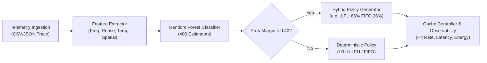

# CacheX – Adaptive Cache Engine

CacheX is an AI-driven cache optimization engine that monitors memory workload telemetry, classifies application access regimes, and dynamically selects the optimal cache replacement policy (**LRU**, **LFU**, **FIFO**, or **Hybrid** blending) to minimize latency and maximize throughput.

---

## 🌟 Architecture & Features



* **Dynamic Workload Classification**: Distinguishes between Database (OLTP), AI/Hot-key, and Streaming/Sequential regimes.
* **Hybrid Cache Policy Generator**: Blends partition ratios (e.g. `LFU 66% FIFO 26%`) when multi-modal traffic patterns are detected.
* **Predictive Prefetching**: Pattern detection on block sequences to minimize cold-start misses.
* **Real-time Observability Dashboard**: Live telemetry simulation for hit rates, miss counts, and energy consumption.
* **Zero-Config Database**: Seamless fallback to SQLite for immediate local execution, with full MySQL support for production.

---

## 🚀 Quick Start (Local Setup)

### 1. Prerequisites
* Python 3.10+
* Node.js 18+

### 2. Backend Setup
```bash
# Navigate to the project root
cd Backend

# Install dependencies
pip install -r requirements.txt

# Start the FastAPI server
uvicorn main:app --host 0.0.0.0 --port 8000 --reload
```
The API documentation is interactively available at: `http://localhost:8000/docs`

### 3. Frontend Setup
```bash
# Navigate to the frontend directory
cd Frontend

# Install packages
npm install

# Start Vite development server
npm run dev
```
Access the dashboard at: `http://localhost:5173`

---

## 🐳 Docker Deployment

To spin up the entire backend containerized:

```bash
docker-compose up --build
```

---

## ⚙️ Environment Variables

Copy `.env.example` to `.env` to configure:

| Variable | Default | Description |
| :--- | :--- | :--- |
| `DATABASE_URL` | `sqlite:///./cachex.db` | SQLAlchemy connection string |
| `MYSQL_USER` | `root` | MySQL user (if using MySQL) |
| `MYSQL_PASSWORD` | *(empty)* | MySQL password |
| `MYSQL_HOST` | `localhost` | MySQL host |
| `MYSQL_DB` | `cachex` | MySQL database name |
| `ALLOWED_ORIGINS` | `*` | Comma-separated CORS allowed origins |
| `MODEL_PATH` | *(auto-detected)* | Path to `random_forest_model.pkl` |

---

## 📊 Workload Telemetry Features & Policies

The model evaluates 4 normalized metrics in `[0.0, 1.0]`:

| Feature | Description | Primary Policy Influence |
| :--- | :--- | :--- |
| **`access_frequency`** | Frequency of memory references | High (>0.61) triggers **LFU** |
| **`reuse_distance`** | Interval between re-references | High (>0.61) triggers **FIFO** |
| **`temporal_locality`** | Recency re-reference likelihood | High recency triggers **LRU** |
| **`spatial_locality`** | Contiguous block locality | Influences throughput and prefetch |

### Verified Test Cases:
* **LRU**: `[0.35, 0.25, 0.92, 0.60]` -> Database / OLTP (97.5% Confidence)
* **LFU**: `[0.95, 0.30, 0.55, 0.45]` -> AI / Model Weights (92.1% Confidence)
* **FIFO**: `[0.30, 0.95, 0.25, 0.90]` -> Media Streaming / Sequential (97.8% Confidence)
* **Hybrid**: `[0.61, 0.30, 0.50, 0.50]` -> Transitional Blend `LFU 66% FIFO 26%` (Margin < 40%)

---

## 🛡️ License
ISC License
